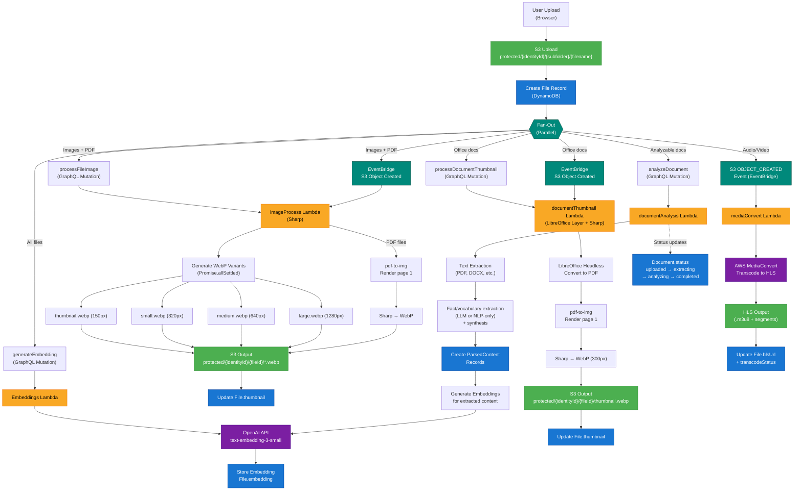
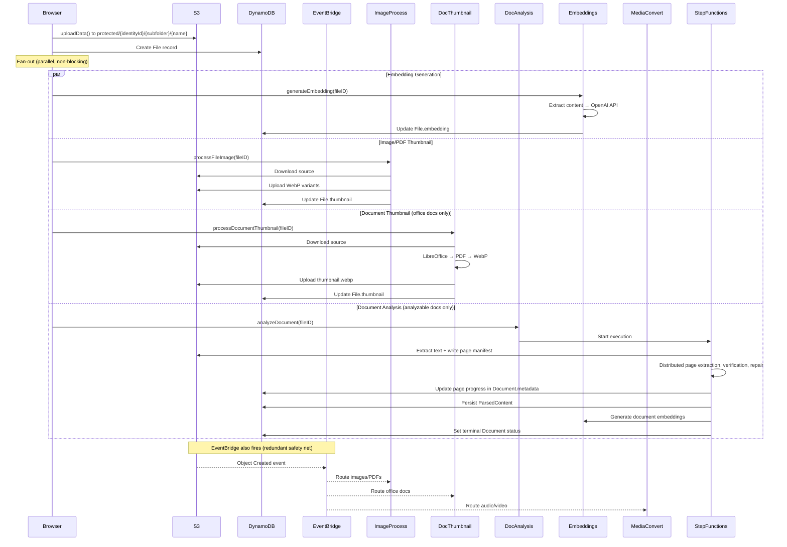

# File Processing Pipeline

Complete architecture documentation for the file upload and processing system.

## Overview

When a file is uploaded, multiple parallel processing pipelines are triggered depending on the file type. The system uses **fan-out** architecture — independent processors run concurrently via EventBridge and explicit GraphQL mutation calls.

```
┌─────────────────────────────────────────────────────────────────────────────┐
│                           FILE UPLOAD                                        │
│                                                                             │
│  Browser → S3 (uploadData) → File record → Fan-out to processors           │
└─────────────────────────────────────────────────────────────────────────────┘
```

## Architecture Diagram



## Pipeline Details

### 1. Image Processing (`imageProcess` Lambda)

| Property | Value |
|----------|-------|
| **Trigger** | `processFileImage(fileID)` mutation + EventBridge S3 Object Created |
| **Input** | Images (JPEG, PNG, GIF, WebP, TIFF, BMP, SVG) and PDF files |
| **Runtime** | Node.js 20, 1024 MB, 120s timeout |
| **Dependencies** | Sharp, pdf-to-img |
| **Output Format** | WebP (next-gen, ~30% smaller than JPEG) |

**Processing stages:**

```
Source Image → Sharp resize → Promise.allSettled (fan-out)
                              ├─ thumbnail (150px max width)
                              ├─ small (320px)
                              ├─ medium (640px)
                              └─ large (1280px)
                              All → WebP conversion → S3 upload
```

**PDF path:**
```
PDF → pdf-to-img (render page 1 at 2x scale) → Sharp → WebP thumbnail → S3
```

**S3 output paths:**
```
protected/{identityId}/{fileId}/thumbnail.webp
protected/{identityId}/{fileId}/small.webp
protected/{identityId}/{fileId}/medium.webp
protected/{identityId}/{fileId}/large.webp
```

---

### 2. Document Thumbnail (`documentThumbnail` Lambda)

| Property | Value |
|----------|-------|
| **Trigger** | `processDocumentThumbnail(fileID)` mutation + EventBridge S3 Object Created |
| **Input** | Office documents (.doc, .docx, .xls, .xlsx, .ppt, .pptx, .odt, .ods, .odp, .txt, .md, .csv, .epub, .rtf) |
| **Runtime** | Node.js 20, 1536 MB, 300s timeout |
| **Dependencies** | Sharp, pdf-to-img, LibreOffice Lambda Layer (`shelfio/libreoffice-brotli`) |
| **Output Format** | WebP thumbnail (300px max width) |

**Processing stages:**

```
Document → Download from S3
         → LibreOffice headless (--convert-to pdf)
         → pdf-to-img (render page 1)
         → Sharp (resize 300px + WebP)
         → Upload to S3
         → Update File.thumbnail via GraphQL
```

**LibreOffice Layer:**
- ARN: `arn:aws:lambda:{region}:764866452798:layer:libreoffice-brotli:1`
- Binary at: `/opt/libreoffice/program/soffice.bin`
- Requires Node.js 20 runtime, x86_64 architecture

**S3 output path:**
```
protected/{identityId}/{fileId}/thumbnail.webp
```

---

### 3. Embedding Generation (`embeddings` Lambda)

| Property | Value |
|----------|-------|
| **Trigger** | `generateEmbedding(content)` / `generateEmbeddings(fileID)` mutations |
| **Model** | OpenAI `text-embedding-3-small` |
| **Dimensions** | 512 |
| **Storage** | `File.embedding`, `ParsedContent.embedding`, `Word.embedding`, `Question.embedding` |

**Processing stages:**

```
Content (text string or file content)
  → OpenAI Embeddings API (text-embedding-3-small)
  → Vector (512 dimensions)
  → Store in S3: private/{identityId}/embeddings/{model}/{id}.json
```

**Used for:**
- Semantic search across files, vocabulary, and questions
- Content similarity matching
- AI-powered content recommendations

---

### 4. Document Analysis (`DocumentAnalysisWorkflow`)

| Property | Value |
|----------|-------|
| **Trigger** | `analyzeDocument(fileID)` mutation or S3 upload EventBridge rule |
| **Orchestration** | AWS Step Functions Standard workflow with a Distributed Map (10 pages at a time per document) |
| **Cancellation** | `cancelDocumentAnalysis(fileID)` stops the recorded execution |
| **Input** | PDF, DOCX, and other text-bearing documents |
| **Output** | One or more `ParsedContent` records per document (a long document is split by page into chunks); extracted text, page inputs, page results, and aggregation artifacts are stored in S3 |

**Status progression:**

```
uploaded → analyzing (preparing → page analysis → aggregation → embeddings)
         → completed (standard, including reported failed pages)
         → failed (workflow error, or any failed page in exhaustive profile)
         → cancelled (if the user stops the execution)
```

**Processing stages:**

```
File in S3
  → Entry Lambda atomically claims a document run; duplicate starts reuse it
  → Prepare: format-aware text extraction, page segmentation, S3 manifest
  → Distributed Map: extract and deterministically check each page
  → When enabled, verify with Anthropic when configured, otherwise OpenAI; repair suspect pages
  → When enabled, render sparse-text pages and run vision fact/vocabulary extraction
  → When disabled, extract explicit labels/glossary entries and select vocabulary with local NLP; verify deterministically
  → Retain extracted page candidates for human editing, including verifier-rejected entries with warnings
  → Aggregate page results; LLM-mode direct entries must match page candidates, while NLP-only retains structured direct entries
  → Hierarchically synthesize and independently verify summaries/objectives/concepts
  → Moderate combined source and results
  → Persist ParsedContent, generate embeddings, then set terminal Document status
```

`PlatformSettings.documentAnalysisLlmExtractionEnabled` controls the platform
default for fact and vocabulary extraction and defaults to `false` (NLP-only).
Each user's nullable `Settings.documentAnalysisLlmExtractionOverride` can inherit
the platform setting or explicitly enable/disable LLM extraction. NLP-only mode
extracts facts from explicit `Label: value` and repeated glossary-style entries,
uses the configured deterministic vocabulary selector, and performs source
checks without LLM repair or verification. Unstructured prose and image-based
facts/vocabulary may be missed; those image findings are reported for review.
This setting does not disable embedded-image descriptions, synthesis,
moderation, or embedding generation, which remain separate workflow stages.

Exhaustive vocabulary extraction requires a verbatim definition and an exact
source quotation in `context` containing that definition. Evidence comparison
normalizes whitespace, case, and quotation-mark styles, but not changed words.
Non-quoted references
such as "Definition on page 1" trigger up to two targeted corrections against
the same source text, with validation reasons supplied to the model. Persistent
evidence failures become explicit human-review warnings, not terminal run
errors or silently discarded vocabulary. The latest structurally valid
extraction is retained after the two correction attempts. Text splitting remains for
truncated or structurally incomplete responses. Header hints are not source
evidence, and split extraction requests do not repeat the full page header.
Each exhaustive response also includes a procedural `checklist`: source page,
reviewed fact/vocabulary counts, vocabulary-evidence and coverage review flags,
and any missing source lines. Code validates the page, counts, flags, and quoted
vocabulary evidence; an incomplete checklist or reported omissions enters the
same two-correction loop before human-review warnings are recorded. Self-reported completion does
not bypass the deterministic coverage scan or independent model verification.
Verifier-rejected questions/vocabulary and uncovered source lines remain
available for human review with reasons. The File Manager and vocabulary/question
review screens display those warnings without disabling editing or import.
Completion means processing finished, not that every candidate is verified.
Only independently supported, deterministically checked candidates feed
summary synthesis; flagged vocabulary/questions are retained for review, not
silently promoted into verified source material.
Moderation blocks remain unchanged. Provider/storage errors, malformed or
truncated responses that cannot be recovered, and malformed, duplicate or
out-of-range verifier verdicts still fail explicitly. Missing verdicts instead
mark the affected candidates unverified with human-review warnings: those
questions/vocabulary remain editable/importable but do not feed verified
summary synthesis. Missing synthesis verdicts drop the affected synthesized
items and log a warning.
Concurrent upload/manual starts use a conditional `_version` claim and return
the active run instead of superseding it. The execution ARN is recorded in that
claim before Step Functions starts; no late registration write can overwrite
workflow progress. Re-analysis starts a new execution only after completion,
failure, or cancellation. Cancel an active execution before restarting it.
Workflow document updates also increment `_version` with a conditional write
and bounded conflict retries, re-reading metadata and checking run ownership
again before retrying. This delivers progress/review warnings to version-guarded
subscriptions without overwriting concurrent metadata or a newly started run.
Deploy the backend change and re-analyze existing files to apply this contract;
previously persisted results are not rewritten automatically.

### Optional deterministic English vocabulary selection

Set `File.settings.vocabularySelection` to `"hybrid-en"` to select this
deterministic English vocabulary path explicitly. It is also selected
automatically when LLM fact/vocabulary extraction is disabled and no selector
was configured. For example, merge this setting with existing settings:

```json
{"analysisProfile":"exhaustive","vocabularySelection":"hybrid-en"}
```

With LLM extraction enabled, the default (or explicit `"llm"`) preserves the
existing multilingual path. Explicit `"hybrid-native"` remains in effect in
NLP-only mode. There is no language auto-detection. Invalid selector values are
explicit configuration errors.

- Pinned Node dependencies: `wink-nlp` 2.4.0, `wink-eng-lite-web-model` 1.8.1
  (lemmatization, POS and stop-word flags), and `subtlex-word-frequencies` 2.0.0
  (74,286 spoken-English frequency entries). The npm package named `wordfreq`
  is not the Python frequency database and is not used.
- The selector preserves explicit `term - definition` / en-dash / em-dash
  entries, including bold Markdown terms, multiword terms, singular annotations,
  and immediately following numbered explanation lines. Structural chapter
  headings are excluded. Explicit entries are not subject to rarity or count caps.
- Prose candidates must be English alphabetic content tokens tagged as nouns,
  adjectives or verbs, not stop words, repeated at least twice across the
  document, with reference frequency at most 20 per million. Their rank is
  `(1 + ln(documentCount)) * -ln((corpusCount + 1) / (corpusTotal + corpusVocabularySize))`.
  The top 40 supplement explicit entries, with stable lemma tie-breaking.
  This is document-frequency-boosted corpus surprisal, **not TF-IDF**, KeyBERT,
  an academic-word-list score, or a grade-level estimate. Out-of-corpus terms
  are labelled as such, not asserted to be advanced vocabulary.
- Selection happens once on the extracted document before page fan-out.
  Private `vocabulary-selection.json` and page-input artifacts retain terms,
  lemmas, source quotes/pages, counts, scores, reasons and selector version
  `english-subtlex-v1`. Repair reuses that shortlist. If vision reveals
  additional text, that page can add explicit/ranked terms from the newly
  transcribed content (up to 40 ranked supplements per vision page); updated
  page-input artifacts retain those additions.
- With LLM extraction enabled, the LLM extracts facts and enriches the supplied
  vocabulary shortlist. Code discards unselected terms, copies explicit source
  definitions, and pins every vocabulary context/page to its selected source.
  For ranked prose terms it asks for concise, plain-English learner definitions.
  Missing definitions leave editable entries with explicit review warnings,
  rather than silently dropping the selected terms.
- In NLP-only mode, only explicit labeled/glossary-style facts are extracted.
  Selected terms receive source definitions when present; missing definitions
  remain editable with review warnings instead of invoking a model.
- Generated definitions may paraphrase. Independent verifier support and a
  real source quote are still required before those entries feed verified
  synthesis. This does not relax fact answer checks or moderation gates.

This first slice does not add example-sentence storage, learner-age targeting,
a smaller summary model, classifiers, or cross-run content-hash caching.
Existing ParsedContent persistence remains; per-run diagnostic artifacts retain
the normal 14-day expiration. It does not change or bypass the seed recall gate.
SUBTLEX reflects spoken US English, not curriculum importance; review shortlist
quality on representative documents before broader rollout. Full-document
corpus statistics are retained in the workflow path; legacy processing computes
them from its available text pages.

### Optional native multilingual vocabulary selection

The opt-in `"hybrid-native"` mode runs a Node handler that launches native
Python using `python-shell` 5.0.0. It uses Stanza 1.15.0 for tokenization,
multiword expansion where applicable, POS tagging and lemmatization, and
wordfreq 3.1.1 (including its CJK tokenizer dependencies) for language-specific
reference frequencies.

Merge the selection and source-language settings into the File's existing settings:

```json
{"vocabularySelection":"hybrid-native","vocabularyLanguage":"es"}
```

The initial image bundles Spanish (`es`), French (`fr`), German (`de`),
Portuguese (`pt`), Italian (`it`), simplified Chinese (`zh`, Stanza `zh-hans`),
Japanese (`ja`) and Arabic (`ar`). English keeps the existing `"hybrid-en"`
mode. There is no automatic language detection, mixed-language routing or
language-selection UI. Unsupported or missing languages fail explicitly.
Generated definitions use the selected source language.

**Chunking contract**

- The existing workflow invokes a dedicated container Lambda with a private S3
  manifest pointer. Page text and results stay in tagged per-run artifacts,
  rather than overflowing Lambda payloads. The worker reads one page at a time.
- Node sends sentence-aware chunks of at most 12,000 UTF-16 code units through
  JSON-lines stdin, awaiting an acknowledgement before sending the next chunk.
  Original page numbers and text are preserved; there is no overlap or repeated
  token counting. Oversized sentences are split at whitespace where possible,
  without cutting surrogate pairs, and cause an explicit review warning.
- Python loads one language pipeline per document process and aggregates lemma
  counts across all chunks/pages before ranking. No per-chunk top-40 filtering
  is applied. Explicit dash-defined glossary terms retain their source
  definitions, quotes and pages, independently of rarity thresholds.
- Repeated noun/adjective/verb lemmas with reference frequency at most 20 per
  million are ranked by
  `(1 + ln(documentCount)) * -ln(max(referenceFrequency, 1e-9))`.
  Reference frequency is the maximum of the first observed surface form and
  its lemma frequency, not an invented corpus count. Up to 40 ranked terms
  supplement all explicit terms. OOV status is explicit, not a difficulty claim.
- Sentence-preserving chunk changes retain the same aggregate counting/ranking
  policy; splits inside a sentence can affect NLP context and require review.
  Vision additions are selected separately on newly transcribed page content,
  as in the English mode, so their supplements can exceed the initial global cap.
- Repair reuses the saved shortlist. The LLM enriches terms only; independent
  verification, source-quote checks, moderation and human-edit warnings remain.

The dedicated image contains Node 22, Python 3.12, CPU-only PyTorch 2.6.0,
Stanza 1.15.0 and wordfreq 3.1.1, **not model weights or pip wheels**. Dependencies
are installed only at image build time; there is no runtime pip installation.
Stanza's `default_fast` models (tokenize/POS/lemma, automatic MWT and pretrain
dependencies, without character language models) are prepared separately with
`stanza.download(..., resources_version="1.15.0")`. Each language has an immutable
S3 release prefix, e.g. `protected/models/stanza-es-v1/` (no leading slash).
The eight configured languages are `es`, `fr`, `de`, `pt`, `it`, `zh`, `ja`, `ar`;
`zh` uses the `zh-hans` model directory. English remains `hybrid-en`.

The Node AWS SDK downloads only the document's configured language from the
storage bucket. This model manifest is distinct from the existing document
manifest, which still references source pages under the private analysis-run
prefix. `modelReleases.json` pins the SHA256 of each model manifest in the
deployed code; the manifest pins the Stanza/resources versions and each file's
size and SHA256. Runtime validates language, versions, allowed paths, duplicate
entries, required processors, at most 16 files, a 64 KiB manifest and a 768 MiB
total per-language size limit. Downloads are streamed with byte limits,
checksummed in a staging directory and atomically renamed into
`/tmp/stanza-models/<release>-<manifest-sha256>`. Warm cache files are reverified
before use; corruption, missing releases and deadline cancellation fail
explicitly rather than using unverified weights. Stanza network downloads are
disabled. The Lambda role has read-only S3 model access scoped to
`protected/models/*`; private document artifact permissions are unchanged.
The subprocess receives a
restricted environment without AWS credentials or API keys. Only protocol JSON
is accepted on stdout; failures, malformed responses, output limits, missing
models and timeout errors stop processing explicitly. It has no silent
English/LLM fallback. Each document starts a fresh Python process; models are
reused across its chunks, not across document invocations.

The container Lambda has 3 GB memory, 4 GiB ephemeral storage and an 840-second
timeout (including cold model download). There is still a
single Lambda invocation per document, not resumable distributed processing:
chunking bounds NLP input memory but does not remove Lambda's execution limit.
The current worker caps unique eligible lemmas at 200,000 and individual S3
JSON inputs at 16 MiB. Keep an eye on model size, build/download time and
document latency before rollout.

Prepare models and build/validate without deploying or uploading:

```bash
# Use the previously preserved all-model image, not the model-free local image.
docker image inspect homework-native-vocabulary:with-models-v1
# Export the preserved image's models for offline reuse:
npm run native-vocabulary:models:prepare

npm run native-vocabulary:build
# For a fresh release instead of the export above, prepare pinned models using
# the image's installed dependencies. This is a preparation job, not Lambda:
npm run native-vocabulary:models:prepare -- --download

npm run native-vocabulary:models:package
# Include the reviewed catalog in the runtime image after packaging:
npm run native-vocabulary:build
npm run native-vocabulary:smoke
```

Choose either offline export or fresh preparation; an ordinary image build
never needs models. Packaging automatically runs preparation first, reusing an
existing complete source directory or exporting the preserved all-model image.
The explicit `--download` option uses `stanza.download()` when source is absent;
it never replaces existing source models. Review generated catalog changes before deployment. The
packager refuses to replace a different local release. The v1 release names are
defined in `modelAssets.ts`: changing weights or library versions requires new
release names and reviewed pins, not overwriting v1. Keep generated release
directories available for publishing and smoke tests; they are gitignored and
excluded from Docker assets. No dependency manifest changes are needed.

Publishing is a separate, **user-authorized** large-asset operation:

```bash
npm run native-vocabulary:models:upload
```

The publisher validates local checksums against the committed catalog and uses
conditional `If-None-Match: *` writes with S3 SHA256 checksums. Identical objects
are reused on retries; differing content is rejected, never overwritten.
Transient streaming failures such as EPIPE are retried up to three times with
fresh file streams and exponential backoff. Rerunning the upload command also
reuses verified objects from earlier attempts.
Each language manifest is uploaded last, after all its files. The publishing
command defaults to the storage bucket and region in `amplify_outputs.json`;
`npm run native-vocabulary:models:upload -- --outputs PATH` selects another
outputs file and `--bucket NAME` overrides
the bucket. After all eight releases verify, it atomically replaces
`protected/models/live/manifest.json` with pointers and checksums for those
releases. This publishing alias does not change checksum-pinned runtime loading;
a failed release upload leaves the previous live alias untouched. The publishing
identity needs GetObject/PutObject for these prefixes (and KMS permissions if
the bucket uses a customer-managed key); Lambda receives no model-write grant.
Publish all eight pinned releases **before** enabling this image in a deployed
backend. Neither packaging nor building deploys or uploads assets.

The smoke command mounts packaged model fixtures read-only and emulates S3
through the real AWS SDK HTTP-handler boundary. It exercises cold download and
verified warm-cache reuse, then runs all eight real language models through
Node/Python with multi-chunk documents, networking disabled, a read-only root
filesystem, writable disk-backed `/tmp`, a non-root user and a 3 GB memory limit.
It rejects images still containing `/opt/stanza_resources`. Override
`NATIVE_VOCABULARY_IMAGE` or `STANZA_MODEL_FIXTURES` to select another image or
fixture release directory. This is not a live S3/IAM integration test.
Docker must be available to build/publish this new Amplify container resource.
Existing extraction Lambdas retain their ZIP packaging and references; a new
NLP-only Lambda is added instead of replacing them. Deployment remains
user-managed. Stanza code, model treebanks and wordfreq datasets have separate
licenses/attribution requirements; review bundled model/data licensing before
redistribution.

**Records created:**
- `Document` — top-level analysis record with status tracking
- `ParsedContent` — consolidated vocabulary, summaries, objectives, concepts, and questions for the document, stored as page chunks when it is long (`chunkIndex`, `chunkCount`; chunk 0 is the primary record). Embedding metadata is stored with the record; vectors are stored in S3.
- `Document.metadata.analysis` — run ID, state, execution ARN, page progress, failed page numbers, verification quality counts, `reviewWarnings`, and `reviewWarningCount`. The UI metadata includes at most 50 warning messages of 600 characters each to bound record size; complete warning details remain in the page/aggregate S3 artifacts (subject to their retention below). Re-analysis replaces the previous run's warnings; editing/importing entries does not automatically clear them.
- `Document.metadata.analysis.moderation` — moderation result for the source and aggregate. Flagged results remain available for review but are blocked by the normal review UI and import utilities. This is not yet a server-side guard on direct Word/Question GraphQL mutations.
- `AgentJob` — one record per document/run (`responseId` equals the analysis run ID), with per-model token counts. No estimated cost is written because no versioned model-price source is configured.
- `ParsedContent` authorization — Owners/Admins have full access; Instructors can read; Learners have no model-level read access.
- Temporary analysis artifacts and Map results expire from S3 after 14 days.
- The Thoth seed reports this progress while polling; its 60-minute default deadline is configurable with `THOTH_ANALYSIS_TIMEOUT_MINUTES`.
- Shared DynamoDB-backed per-provider RPM/TPM/concurrency limits are implemented in source and editable through Admin Platform Settings; demo mode caps them at 5 RPM, 20,000 TPM, and 1 concurrent request. Final `ParsedContent` persistence splits the result by page into chunk records (see "ParsedContent chunking" in `DOCUMENT_ANALYSIS_QUEUE_PLAN.md`) rather than rejecting large documents. CDK synthesis/deployment, limiter fairness and latency, failed-page redrive, and runtime behavior remain unverified.
- Importing a question or word writes a `DocumentQuestion` / `DocumentWord` link to the document, storing only the two IDs and the owner. The importer also records on each imported `ParsedContent` entry the `questionID` / `wordID` it became; the entry's page and source snippet are found through that id, and the review screens mark an entry imported when its id has a live link, so a later page of a partly imported document can still be imported; question and word rows show their source file and page; the recycle-bin confirmation for a file says how many questions and words were imported from it (they stay in the banks); and practice drills cite each item's page and can be limited to chosen documents (`documentIds` in `sourcesEnabled`, supported by the server action and the Lambda; there is no picker in the drill dialog yet).

---

### 5. Media Conversion (`mediaConvert` Lambda + AWS MediaConvert)

| Property | Value |
|----------|-------|
| **Trigger** | S3 OBJECT_CREATED event via EventBridge (`S3VideoUploadRule`) |
| **Input** | Audio files (MP3, WAV, M4A, etc.) and video files (MP4, MOV, WebM, etc.) |
| **Output** | HLS streaming format (.m3u8 manifest + .ts segments) |
| **Service** | AWS Elemental MediaConvert |

**Processing stages:**

```
Audio/Video upload
  → Lambda creates MediaConvert job
  → MediaConvert transcodes to HLS
     ├─ Video: 720p, 480p, 360p bitrate ladder
     └─ Audio: AAC
  → EventBridge Job State Change notification
  → Lambda updates File.hlsUrl and File.transcodeStatus
```

**S3 output path:**
```
protected/{identityId}/{fileId}/{fileId}.m3u8    (manifest)
protected/{identityId}/{fileId}/{fileId}_*.ts    (segments)
```

---

## Complete Upload Sequence

When a user uploads a file through the browser, the following sequence executes:



## File Type Routing

| File Type | Image Process | Doc Thumbnail | Doc Analysis | Embeddings | Media Convert |
|-----------|:---:|:---:|:---:|:---:|:---:|
| JPEG, PNG, GIF, WebP, TIFF, BMP, SVG | ✅ | — | — | ✅ | — |
| PDF | ✅ (page 1) | — | ✅ | ✅ | — |
| DOC, DOCX | — | ✅ | ✅ | ✅ | — |
| XLS, XLSX | — | ✅ | — | ✅ | — |
| PPT, PPTX | — | ✅ | ✅ | ✅ | — |
| ODF (.odt, .ods, .odp) | — | ✅ | ✅ | ✅ | — |
| TXT, MD, CSV, RTF | — | ✅ | ✅ | ✅ | — |
| EPUB | — | ✅ | ✅ | ✅ | — |
| MP3, WAV, M4A, AAC | — | — | — | ✅ | ✅ |
| MP4, MOV, WebM | — | — | — | ✅ | ✅ |

## Dual-Trigger Pattern (Redundancy)

Each processor is triggered **two ways** for reliability:

1. **Explicit mutation call** — immediate, triggered by the browser after upload
2. **EventBridge S3 Object Created** — automatic, triggered by S3 (safety net for retries, re-uploads, or direct S3 writes)

Both triggers are idempotent — the Lambda checks if processing is already complete before re-running.

## S3 Path Convention

```
protected/{identityId}/
├── images/{filename}           ← Source image uploads
├── audio/{filename}            ← Source audio uploads
├── files/{filename}            ← Source document uploads
└── {fileId}/
    ├── thumbnail.webp          ← 150px (images/PDF) or 300px (documents)
    ├── small.webp              ← 320px (images only)
    ├── medium.webp             ← 640px (images only)
    ├── large.webp              ← 1280px (images only)
    └── {fileId}.m3u8           ← HLS manifest (audio/video)
```

## Infrastructure (CDK / Amplify Gen 2)

| Resource | Stack | Purpose |
|----------|-------|---------|
| `S3ImageUploadRule` | EventBridge Rule | Routes image/PDF uploads to imageProcess |
| `S3DocumentUploadRule` | EventBridge Rule | Routes document uploads to documentThumbnail |
| `LibreOfficeLayer` | Lambda Layer | LibreOffice binary for document conversion |
| `ImageProcessAppSyncPolicy` | IAM Policy | GraphQL access for imageProcess |
| `DocumentThumbnailAppSyncPolicy` | IAM Policy | GraphQL access for documentThumbnail |
| Storage bucket `grantReadWrite` | S3 IAM | Read source files, write processed output |

## Environment Variables

Both Lambda functions require:

| Variable | Source |
|----------|--------|
| `API_ENDPOINT` | AppSync GraphQL URL |
| `STORAGE_BUCKET` | S3 bucket name |
| `AWS_REGION` | Auto-provided by Lambda runtime |
