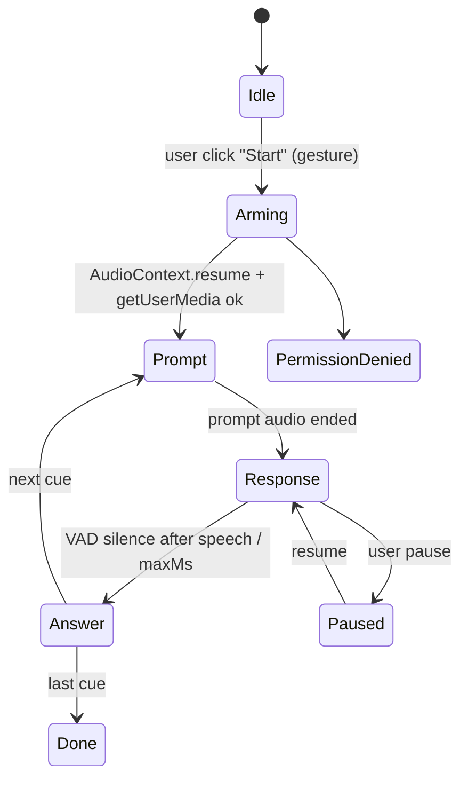

# Thoth Correspondence Deck — Pipeline Accuracy, Course Section & Call-and-Response Plan

Status: **Implemented in code through Phase 6; live-sandbox validation pending** (see §11) · Owner: TBD · Created 2026-10-15

## 0. Goals

1. **Test the document pipeline for accuracy.** Upload *Thoth Tarot — Correspondence flashcards (LONG-edge flip)* (52 pages, 100 cards) in the seed script. Then show that the pipeline pulls out **every** knowledge fact and **every** vocabulary term. Missing items are failures, not warnings.
2. **Build a Section of Units** from the extracted data: Trumps, Small Cards, Court Cards, Reference/Glossary, and special-topic units for interesting card groups.
3. **Add a new "call and response" exercise.** It is a conversation playlist that alternates three parts: prompt, a response window filled with room tone, and the spoken answer. It records the learner only during response windows and grades each answer for accuracy. One conversation per card.
4. **Add a media-player variant for call and response.** It shows a slide synced to the speaker. A slide is either flashed text or read-only Lexical content.
5. **Build a spoken playlist.** Generate and store audio for each prompt and answer through the authenticated OpenAI TTS mutation. Keep learner response windows and their silence timing in playlist cue metadata; do not bake silence into speech or stitch a local audio album.
6. **Save everything to the seed fixture** (`test/integration/seed-data.json`) so later record-building can reuse the IDs and extracted data without calling the LLM again.

---

## 1. Current-State Findings (verified in code)

| Area | File | Finding | Impact |
|---|---|---|---|
| Batching | [amplify/functions/documentAnalysis/analysis.ts](../amplify/functions/documentAnalysis/analysis.ts#L21-L22) | `PAGES_PER_BATCH = 10`, `MAX_PARALLEL_BATCHES = 5` | Each 10-page batch of dense card backs goes into one GPT call, so output can get truncated. |
| Question count | [analysis.ts](../amplify/functions/documentAnalysis/analysis.ts#L56) | The prompt asks for **"2-3 custom answer questions per batch"** with 200–300-word answers | 52 pages gives about 15 essay questions. The deck has about 1,000 atomic facts. **This is the main reason questions get missed.** |
| Failure handling | [analysis.ts](../amplify/functions/documentAnalysis/analysis.ts#L84-L88) | A batch error returns `success:false`. `finish_reason === "length"` is not checked and a failed batch is not split and retried | Pages can drop out silently. |
| Coverage | analysis.ts | Nothing checks that every page produced items | There is no proof of completeness. |
| Question shape drift | [amplify/seed/seed.ts](../amplify/seed/seed.ts#L2036) vs analysis.ts | The seed writes `{question, expectedAnswer, type}`, while the Lambda writes `{prompt, answer, hint, difficulty, questionType}` | These need to be reconciled before any grading code reads `questionsJSON`. |
| Seed analysis | [seed.ts](../amplify/seed/seed.ts#L2030-L2080) | `ParsedContent` is **hand-written**, not produced by the pipeline | The seed does not test the pipeline today. |
| Seed fixture | [seed.ts](../amplify/seed/seed.ts#L3990-L3992) | IDs are written to `test/integration/seed-data.json` | This is the right place for the `thoth` block. |
| Mock files | [seed.ts](../amplify/seed/seed.ts#L1446) | `mocksDir = test/mocks` | The PDF goes here. |
| Conversation node | [ConversationPlaylistPlugin.jsx](../src/components/Editor3/plugins/ConversationPlaylistPlugin.jsx#L40-L55) | `conversation-playlist` v1: `fileIDs`, `dialogue[{id,speaker,text,timing,stillFileID?,audioFileID?}]` | It has no pauses, response windows or grading. |
| Player | [ConversationPlayerComponent.jsx](../src/components/Editor3/components/ConversationPlayerComponent.jsx) | Plays one track at a time and syncs subtitles | We can reuse its subtitle/still logic. |
| Mic + analyser | [useAudioRecordingTakes.ts](../src/components/Editor3/hooks/useAudioRecordingTakes.ts#L154-L158), [AudioWaveformPlayer.jsx](../src/components/Editor3/components/AudioWaveformPlayer.jsx#L909-L1018) | `getUserMedia` + `createAnalyser` patterns already exist | Reuse them; don't write a third mic stack. |
| Visualizers | [FrequencyRingVisualizer.jsx](../src/components/Editor3/components/FrequencyRingVisualizer.jsx), [PlaybackWaveformVisualizer.jsx](../src/components/Editor3/components/PlaybackWaveformVisualizer.jsx) | Take an analyser or stream | Mount them only during response windows. |
| Read-only Lexical | [NarrativeReader.tsx](../src/components/Editor3/NarrativeReader.tsx) | Read-only renderer with no context | Use it for slide rendering. |
| Transcription | [amplify/data/resource.ts](../amplify/data/resource.ts#L3065) `verifyAudioUrl`, `generateAudioFile` (L3168), `analyzeDocument` (L3213) | Whisper STT and TTS are exposed; `verifyAudioUrl` accepts an optional Whisper `prompt` | Vocabulary-biased transcription is supported by the schema and handler; callers that omit the prompt retain the existing behavior. |
| Mic mocking | [AudioWaveformPlayer.stories.jsx](../src/components/Editor3/components/AudioWaveformPlayer.stories.jsx#L289-L298) | A tone stream replaces `getUserMedia` | Reuse this for player stories. |

---

## 2. Source Document Anatomy (drives ground truth)

- **Page 1**: cover and print instructions. It holds facts: 100 cards, colour key, "read by dignity, not reversal", "chakras are an overlay".
- **Page 2**: blank. It is expected to produce nothing; the coverage check whitelists it.
- **Odd pages 3–51**: FRONTS, 4 cards each (title + subtitle).
- **Even pages 4–52**: BACKS. **They are mirrored left/right per row (long-edge flip).** Text order on a back page is `[TR, TL, BR, BL]` relative to the front. Pair fronts and backs by **normalised card title**, never by position.
- **Count**: 22 Trumps · 4 Aces · 36 small cards · 16 Courts · 22 Reference cards (4 of them Glossary, 40 terms).

### Known extraction hazards (record in ground truth, don't "fix" in the source)

| Hazard | Example | Rule |
|---|---|---|
| Hebrew glyphs garble in text extraction | `ח Cheth` comes out as `n Cheth`; `ו Vau` comes out as `ı Vau` | Grade on **transliteration**: `Cheth (Ch)`. Treat the glyph as optional. |
| Missing font glyph in the source | p.42 *Four Suits & Worlds*: "one letter of ■■■■" (YHVH) | The ground truth marks it `sourceDefect: true`. The pipeline must not invent a value. |
| Astro glyphs | ♈ ☿ ♄ △̵ | Grade on the word ("Aries"). Glyph → word mapping lives in the Glyphs reference card. |
| Colour swatches exist only as names in the text | "K Bright pale yellow" | Hex values are image-only and out of scope. Grade the **colour names** K/Q/P/Pr. |
| Boilerplate repeated on many cards | "Terms — Path: …", "Read as: a PERSON…" | Dedupe. Each term becomes **one** vocabulary entry and **one** question, not 16. |
| Counterchange note | Emperor = Tzaddi/path 28; Star = Heh/path 15 | These are high-value facts. They must exist as explicit questions. |

---

## 3. Ground Truth & Extraction Grading

### 3.1 Ground-truth fixture (no production code; no confirmation needed)

`test/fixtures/thoth/thoth-ground-truth.json` — hand-checked against the PDF:

```ts
interface ThothGroundTruth {
  source: { filename: string; pages: 52; sha256: string };
  cards: ThothCard[];             // 100
  vocabulary: GTVocab[];          // see 3.2
  pageIndex: Record<number, string[]>; // page → cardKeys (blank: [])
}
interface ThothCard {
  key: string;                    // "trump-01-magus", "wands-02", "court-wands-knight", "ref-glossary-astrology"
  group: "trump" | "ace" | "small" | "court" | "reference";
  frontPage: number; backPage: number;
  title: string; subtitle: string;
  facts: GTFact[];
}
interface GTFact {
  field: string;                  // "hebrewLetter" | "path" | "sephiraA" | "decanPlanet" | "sunDates" | "colourK" | ...
  value: string;                  // canonical answer
  accept?: string[];              // "1", "one", "I"
  required: boolean;              // chakra [overlay] facts are required too
  sourceDefect?: boolean;
}
```

**Facts by group (estimate ≈ 950–1,050 atomic facts):**

| Group | Fields per card |
|---|---|
| Trump (22) | number, title, Hebrew letter (translit.), letter value, attribution (planet/sign/element) + its gloss, path no., Sephira pair, zodiac-ring clock & degrees, sun dates (zodiacal only), counterchange note (IV, XVII), chakra [overlay], meaning, K/Q/P/Pr colours |
| Ace (4) | title (Root of…), element, Kether in World, World, rank sense, chakra, meaning, colours |
| Small (36) | title, decan planet, sign, decan ordinal and degree range, sun dates, ring position, Sephira, World, rank sense, chakra, meaning, colours |
| Court (16) | element-of-element, zodiac span (20°–20°), sun dates, cusp sign and date, ring position, Tetragrammaton letter, Sephira, World, rank sense, chakra, personality cue, colours. Princesses have **no dates**, but they have "Rules: quadrant… Throne of the Ace" |
| Reference (22) | each enumerated statement (e.g. "Fire & Air are friendly", "Chaldean order = Saturn…Moon", "Emperor takes Tzaddi") |

### 3.2 Vocabulary ground truth (all required)

| Set | Count |
|---|---|
| Glossary terms (4 glossary cards) | 40 |
| Sephiroth | 10 |
| Four Worlds | 4 |
| Classical planets | 7 |
| Signs | 12 |
| Elements (+ Spirit) | 5 |
| Hebrew letters (on Trumps) | 22 |
| Court ranks | 4 |
| Card titles (78 + 22 reference) | 100 |
| Terms-line jargon not already listed (Overlay, Zodiac ring, Cusp, Rising sign, Querent, …) | remaining distinct |

Normalise with case-folding, diacritics stripped and plural→singular, plus an alias list (`Sephira`/`Sephiroth`, `Tetragrammaton`/`YHVH`).

### 3.3 Scorer — `test/integration/thoth/scoreExtraction.ts` + unit tests

Inputs: ground truth plus the `ParsedContent` (+ `DocumentQuestion`/`DocumentWord` if they are populated).

Each ground-truth fact is matched to an extracted question in this order:
1. **Card and field scoping.** The question's `page` must be one of the card's pages and its structured `subject` (card key or normalised title) and `field` must identify this card and fact. For legacy items without those fields, both the prompt and page must identify the card and the prompt must identify the fact field. A shared page alone is never enough: pages can contain several cards, and identical answers must not cross-satisfy facts.
2. **Answer match.** Normalised exact, then `accept[]`, then token-set ratio ≥ 0.9. Apply fuzzy matching only after the card and field have been established.

Facts marked `sourceDefect: true` are documentation of a known source limitation, not extractable truth. They must not count in required `factRecall` or the pass/fail gate, and the pipeline must not infer or invent their answer. Report them separately if useful. Keep page coverage separate: page 42 still needs other extracted content.

Outputs `test/integration/thoth/extraction-report.json`:

```json
{ "vocabRecall": 1.0, "factRecall": 0.987, "pageCoverage": { "missing": [] },
  "missingFacts": [{ "card": "trump-17-star", "field": "path", "expected": "15" }],
  "duplicates": 3, "unmatchedExtracted": 12 }
```

**Gate:** `vocabRecall === 1` **and** `factRecall === 1` (required facts) **and** no pages missing except page 2. The seed **fails loudly** unless `SEED_THOTH_ALLOW_PARTIAL=1`. Precision (`unmatchedExtracted`) is reported but does not gate the run. Spot-check those items by hand.

---

## 4. Pipeline Changes (`amplify/functions/documentAnalysis/` — **needs confirmation**)

Keep the defaults as they are for other documents. Add an opt-in **exhaustive** profile:

1. **Profile selection.** Read `analysisProfile: "standard" | "exhaustive"` from the `File.settings` JSON. This avoids changing the `analyzeDocument` mutation schema; keep the standard profile as the default when the setting is absent or invalid, and log invalid values explicitly.
2. **Page-sized batches.** Exhaustive uses `PAGES_PER_BATCH = 1` (2 at most), so each card back gets its own call. Keep `MAX_PARALLEL_BATCHES` at 5 and add 429 backoff.
3. **Structured Outputs.** Use `response_format: { type: "json_schema", strict: true }` with a recall-item schema: `{ facts: [{ subject, field, answer, accept[], page, sourceText }] }`. Map each fact into `questionsJSON` as `questionType: "recall"`, `prompt` = templated question and `answer` = short value. This adds no new model field, because `questionsJSON` is already `a.json()`.
4. **Exhaustive instructions.** Ask for: "Every labelled line (`Label: value`) and every enumerated statement becomes one fact. Do not summarise. Do not omit repeated boilerplate the first time it appears."
5. **Deterministic coverage pass, generic rather than Thoth-specific.**
   - A regex finds candidate `Label: value` lines and glossary-style `Term — definition` lines on each page.
   - Any candidate with no matching extracted fact triggers a targeted gap-fill call for that page.
6. **Truncation safety.** On `finish_reason === "length"` or a JSON parse error, split the batch (or the page in halves) and retry. A batch is never dropped silently. Record `failedPages` in `ParsedContent` metadata or logs.
7. **Vocabulary.** Exhaustive asks for every defined term, including glossary cards and `Terms —` lines, and dedupes across pages by normalised term (keeping the first page seen).
8. **Front/back pairing.** Pass `pageRole` hints (front/back/reference) found by header text. Keep the **`page`** on every item so the scorer and unit builder can join on card title.
9. **Question-shape reconciliation.** Standardise on `{prompt, answer, hint?, difficulty?, questionType, page, subject, field, sourceText}`. Preserve the structured `subject` and `field` emitted by extraction as metadata on each question; the scorer needs them to avoid cross-card and cross-field matches. Update the seed mock and any readers (find them via the `questionsJSON` consumers).

Tests: unit-test the coverage regex and batch splitter. Phase 0 scorer tests live in `test/unit/thoth/scoreExtraction.test.ts`; run them with `npm run test:unit -- test/unit/thoth/scoreExtraction.test.ts`. Include regressions where two cards share a page and a wrong-card or wrong-field answer has the same value as the expected fact.

---

## 5. Seed Integration (`amplify/seed/seed.ts` — **needs confirmation**)

New section **"SECTION 11b: Thoth correspondence deck"**, run as instructor1:

1. Read `test/mocks/Thoth-Correspondence-Deck.pdf`. Compute SHA-256 from its bytes and compare it with the ground-truth `source.sha256`; fail before upload or analysis on mismatch in either `live` or `snapshot` mode.
2. Set the mode with `SEED_THOTH_MODE=live|snapshot|off`. The default is `snapshot` if a snapshot exists, otherwise `live`.
   - **live:**
     1. `uploadData` to `protected/{identityId}/files/thoth-….pdf`.
     2. Create `File` with `settings.analysisProfile = "exhaustive"`.
     3. Wait for the S3/EventBridge auto-trigger. **Do not also call `analyzeDocument`**, because that would run analysis twice.
     4. Poll `Document.status` with a timeout (e.g. 15 min) and handle `resumeState`.
     5. Fetch `ParsedContent` and write `test/fixtures/thoth/parsed-content.snapshot.json`.
   - **snapshot:** Upload the PDF so the File exists. Create `ParsedContent` from the snapshot. No LLM cost.
3. Run the scorer, write the report, and apply the gate from §3.3.
4. Build records (see §6): `Word`s from vocabulary, `Question`s from recall facts (tagged `card:<key>`, `field:<field>`), `Section`, `Unit`s with `UnitWord` links, an `Assignment` per unit, and student1 enrolled.
5. Add a `thoth` block to `seed-data.json`:

```json
"thoth": {
  "fileId": "", "documentId": "", "parsedContentId": "", "sectionId": "",
  "units": { "orientation": "", "trumps": "", "small": "", "courts": "", "glossary": "", "aces": "", "counterchange": "", "colourScales": "" },
  "wordIdsByTerm": {}, "questionIdsByCardField": {},
  "callResponse": { "audioManifest": "test/fixtures/thoth/audio-manifest.json" },
  "extractionReport": "test/integration/thoth/extraction-report.json"
}
```

Wipe/reset already uses a DynamoDB scan, so no extra cleanup is needed. Check that the new models are covered.

---

## 6. Section & Units

**Section:** "Thoth Tarot — The Correspondence System" (instructor1, join code, student1 enrolled).

| # | Unit | Source cards | Content |
|---|---|---|---|
| 1 | Orientation: Reading These Cards | Reading, Suits & Worlds, Numbers & Tree, Sephiroth, Colour Scales, Chakras overlay, Zodiac Ring | WordBlocks, Quiz (Sephira ↔ meaning), zodiac ring image |
| 2 | The Trumps (22 paths) | Trumps 0–XXI + Trumps-as-Paths ref | Per card: slide, call-and-response, recall quiz. Sub-headings 0–X / XI–XXI |
| 3 | The Small Cards (36 decans) | 2–10 × 4 suits + 36 Decans ref | Organised by sign (3 decans per sign); Chaldean order drill |
| 4 | The Court Cards (16) | Courts + Court Family, Person/Force/Idea, Significator | Courts with zodiac spans; "which court is your birthday?" CustomAnswer |
| 5 | Glossary & Symbols | 4 Glossary + Glyphs, Planets, Signs, Elements, Worlds | 40-term call-and-response; glyph ↔ name MeaningAssociation |
| 6 | Special: The Four Aces | 4 Aces + Princess cards | Roots of the elements, Kether in four Worlds, Princess as "Throne of the Ace", identical "Brilliance" colour scale |
| 7 | Special: Counterchange (Emperor ↔ Star) | IV, XVII, Trumps-as-Paths | "Tzaddi is not the Star" (AL I.57); signs and colours stay, letters and paths swap |
| 8 | Special: Shared Colour Scales | All 2s share Soft blue/Grey/…; all 10s share Yellow/Citrine… | Pattern recognition: pips take their Sephira's Queen-scale colours |

**Deferred — Three Magus cards (dropped from scope).**
- *Reasonably established:* Harris painted Atu I more than once. Some later printed editions include two alternate Magus cards alongside the standard one. The deck was first printed as cards in 1969, after Crowley (d. 1947) and Harris (d. 1962) had died.
- *Hypothesis, unverified:* the variants relate to Crowley's view of WWII as a war fought on the magical plane. Crowley made wartime claims of his own, such as the V-sign as a counter to the swastika and *Liber Oz* (1941). No source found so far links those claims to the Magus variants.
- *Leads if this is reopened:* Kaczynski, *Perdurabo*; Sutin, *Do What Thou Wilt*; the Crowley–Harris letters (Yorke Collection, Warburg Institute).
- None of this is in the PDF. If it is added later, tag its questions `provenance: "authored"` so the extraction scorer leaves them out.

Each unit's Lexical JSON is built by pure builder functions (`scripts/thoth/buildUnitContent.ts`). The seed and tests both use them. The builders produce standard nodes (`WordBlock`, `Quiz`, `CustomAnswer`, `MeaningAssociation`) plus one `call-response` node per card.

Live Thoth analysis polling follows filtered `Document` and `ParsedContent`
continuation tokens, including empty scan pages, before concluding that no
matching record exists. Each poll starts a fresh scan; GraphQL/network failures
and repeated continuation tokens stop the seed explicitly.

---

## 7. Call-and-Response Exercise

### 7.1 Script model (one conversation = one card)

New Lexical node **`call-response`** (v1), separate from `conversation-playlist` because it is graded and has different timing. Add `"call-response"` to `gradedBlockTypes`.

```ts
interface CallResponseScript {
  cardKey: string; title: string;
  voices: { narrator: string; answer: string };   // TTS voice ids
  roomToneFileID?: string;                          // optional recorded tone; else synthesized
  cues: Cue[];
}
type Cue =
  | { id: string; kind: "prompt";   text: string; audioFileID?: string; slide?: Slide }
  | { id: string; kind: "response"; expected: string; accept: string[]; field: string;
      minMs: number; maxMs: number; silenceEndMs: number; slide?: Slide }
  | { id: string; kind: "answer";   text: string; audioFileID?: string; slide?: Slide };
type Slide = { type: "text"; text: string } | { type: "lexical"; state: SerializedEditorState };
```

**Example (I — The Magus):**

| # | kind | text / expected |
|---|---|---|
| 1 | prompt | "Trump cards… The Magus… number?" |
| 2 | response | `I` (accept `1`, `one`) |
| 3 | answer | "…one." |
| 4 | prompt | "Planet?" |
| 5 | response | `Mercury` |
| 6 | answer | "…Mercury." |
| 7 | prompt | "Hebrew letter?" → Beth · "Path?" → 12 · "Joins?" → Kether and Binah · "King-scale colour?" → Yellow · … |

The generator is the pure function `buildCallResponseScript(card: ThothCard): CallResponseScript` in `src/utils/callResponse/`, with unit tests. Field order: identity → attribution → Hebrew → path/Tree → zodiac/dates → rank → colours → meaning. Chakra [overlay] is optional and goes last.

### 7.2 Pause timing (language-CD heuristic)

`responseWindow = clamp(1.5 × answerTtsDuration + 1.0 s, 2.5 s, 8 s)`. In interactive mode the window **waits for speech**:
- It ends after `silenceEndMs` (700 ms) of post-speech silence, or at `maxMs`.
- If no speech arrives, it holds up to `maxMs`, then plays the answer.

Room tone is pink noise at about −50 dBFS, made in Web Audio. That way the interactive player needs no extra asset. The rendered album bakes the same tone in.

### 7.3 Player state machine — `CallResponsePlayer`



Requirements, mapped to the brief:
1. **Click-tied arming.**
   - The Start click resumes `AudioContext` and opens **one** `MediaStream` (`echoCancellation`, `noiseSuppression`, `autoGainControl` on). The stream stays live for the whole conversation.
   - Starting a `MediaRecorder` later on a live stream doesn't need another gesture. This covers Safari/iOS.
   - MIME fallback: `audio/webm;codecs=opus` → `audio/mp4`.
2. **Visualizer only in response windows.** Mount `FrequencyRingVisualizer` (live mic analyser) only when `state === "Response"`. In other states show the slide and subtitle.
3. **Capture only during responses.**
   - Use a new `MediaRecorder` per response window: start on entry and stop on exit, with no pre-roll. A recorder started at response entry cannot capture audio from before that entry.
   - Allow a ≤ 500 ms post-roll only while VAD still hears speech. Stop and discard the take before prompt or answer playback begins; never preserve prompt/answer audio.
4. **Grading (async, doesn't block playback, CD-style).**
   1. Upload the blob to `protected/{identityId}/call-response/{unitId}/{blockId}/{cueId}-{attempt}.{ext}`, choosing the extension and `contentType` from the recorder's actual MIME type (`audio/webm;codecs=opus` or `audio/mp4` fallback).
   2. Call `verifyAudioUrl` with a Whisper `prompt` of expected terms when available; omit it when no useful bias terms exist.
   3. Score the transcript with `scoreSpokenAnswer(transcript, expected, accept)`: normalise, then numeral/roman/word equivalence, then token-set ratio, then a phonetic fallback (Double Metaphone) for Hebrew/Qabalistic names.
5. **Grade storage.** `Grade.data[blockId] = { complete, accuracy, cues: { [cueId]: { transcript, score, audioPath, attempts } } }`. Save via the existing UnitContext grade update with `_version`.
6. **Hooks.**
   - `useCallResponseSession` (state machine + timing)
   - `useLiveMicStream` (extract from `useAudioRecordingTakes` if it is really shared)
   - `useVoiceActivity` (RMS threshold on the analyser)

### 7.4 Slides

- `type: "text"`: a large flashed title ("The Magus") that mirrors the speaker, shown at cue start.
- `type: "lexical"`: rendered with `NarrativeReader` (read-only), authored in the editor.
- **Future (Phase 6):** graded workbook blocks inside a slide during the response window, such as a Quiz on the screen while the learner speaks. The grade goes to the same `Grade.data[blockId].cues[cueId]`.

### 7.5 Authoring

- `ConversationPlaylistEditor` / RecordingStudio3 gets a **Call & Response** mode:
  - generate cues from a card or from selected `Question`s
  - edit pause overrides
  - pick voices
  - "Generate audio" (TTS per cue, deduped by text hash, so "Planet?" is generated once)
  - preview
- Storybook: `CallResponsePlayer.stories.tsx` with states Idle / Arming / Prompt / Response (mocked mic tone stream, as in AudioWaveformPlayer.stories) / Answer / Done / PermissionDenied, plus a play test that runs a full 3-cue card.

---

## 8. Thoth Spoken Playlist

`scripts/thoth/render-call-response-album.mts` (dev script; not shipped):

1. Build scripts for all 100 cards in deck order. Glossary cards are read term → pause → definition.
2. Generate each distinct prompt/answer cue through the authenticated `generateAudioFile` mutation. The handler uploads the returned bytes to S3 and marks the `File` complete; cache the text hash → File ID/path in `test/fixtures/thoth/audio-manifest.json`.
3. Attach each generated audio File to its prompt/answer cue with `audioFileID`. Response cues do not contain generated audio.
4. Keep response silence programmatic: the player uses each response cue's `minMs`, `maxMs`, and `silenceEndMs` to manage the microphone response window. Do not speak pause markers or concatenate silence into an audio track.

TTS generation is paid and persists files in S3; running the script requires explicit confirmation.

Use `--card trump-0-the-fool` to limit a dry run or execution to one card.
Before any paid generation, the renderer downloads seeded unit content and
checks that every selected card exists with matching spoken cue IDs, text, and
voices. Missing or stale scripts stop the run before TTS; response-window timing
and existing audio references are preserved during this preflight.
The renderer saves each returned File ID/path atomically before polling, so a
timeout or interruption resumes the same generation request on the next run.
Cached cues are checked against their File records and downloaded from S3 to
verify an MP3 header before reuse. Missing records, missing objects, and invalid
audio stop the run rather than silently charging for replacement TTS. A full
sandbox reseed deletes File records; preserve the audio manifest and S3 objects
and restore those records before retrying. The standalone renderer signs in
with Amplify Auth; it does not require the sandbox seed CLI authentication helper.

---

## 9. Phases & Validation

Typecheck the complete seed without executing it:
`npx tsc --project amplify/seed/tsconfig.json`.
This config inherits the backend's strict settings. Passing source files directly
to `tsc` bypasses project settings; disabling strict null checks causes misleading
scalar-to-`string[]` errors in Amplify Grade and AnalyticsSummary input types.

| Phase | Scope | Confirmation? | Validation |
|---|---|---|---|
| 0 | Ground-truth JSON, scorer, scorer unit tests | No (tests/fixtures) | `npm run test:unit -- test/unit/thoth/scoreExtraction.test.ts`; assert wrong-card/field answers cannot satisfy a fact and known source defects do not gate recall |
| 1 | Pipeline exhaustive profile, coverage pass, truncation retry, question-shape reconcile | **Yes** (`amplify/`) | unit tests + sandbox run on the PDF; gate passes |
| 2 | Seed section 11b, snapshot mode, fixture block | **Yes** (`amplify/seed`) | `npm run sandbox:seed`; report at 100% |
| 3 | Unit content builders + Section/Units/Words/Questions | **Yes** (seed) + scripts | Units open in Workbook; story snapshots |
| 4 | `call-response` node, player, hooks, scorer, editor mode | **Yes** (`src/`) | unit tests for state machine/scorer; Storybook play tests; Playwright e2e for Magus card |
| 5 | Album render script + manifest | No (scripts) | listen-through of 3 cards; durations within heuristic |
| 6 | Graded slides during response windows | **Yes** | follow-up plan |

---

## 10. Decisions

1. **PDF:** `test/mocks/Thoth-Correspondence-Deck.pdf`.
2. **Three Magus cards:** dropped from scope (see §6).
3. **Chakra [overlay] facts:** required for the 100% gate.
4. **Transcription:** `verifyAudioUrl` accepts an optional Whisper `prompt` for vocabulary bias; calls without it retain existing behavior. Extraction improves the existing pipeline: unit-sized chunks, a mechanical checklist (vocabulary counts, minimum questions per topic) and sub-tasks to avoid context exhaustion.
5. **Budget:** up to $200 for live extraction and TTS; use snapshots wherever they save money.
6. **Audio storage:** S3 only, with the manifest in the repo.
7. **Production changes:** approved; no further confirmation needed.

---

## 11. Implementation Status

| Phase | State | Evidence |
|---|---|---|
| 0 | Done | `test/unit/thoth/scoreExtraction.test.ts` and the other `test/unit/thoth/` suites pass |
| 1 | Code + unit tests done; **live gate not yet passed** | `test/unit/documentAnalysis.test.ts`, `test/unit/documentAnalysisCoverage.test.ts`. The workflow ran end to end in the sandbox until OpenAI returned `credit_balance_exhausted` |
| 2 | Done in snapshot mode; **live gate not run** | Seeded with a throwaway synthetic snapshot built from the ground truth (deleted afterwards), so this exercised the seed, not extraction accuracy |
| 3 | Done | 8 units and 1,255 recall questions seeded; the Trumps unit opens in the Workbook; `test/unit/thoth/buildUnitContent.test.ts` |
| 4 | Done | Node, player, hooks, authoring, insert command, stories, and `test/e2e/call-response.spec.ts` passing against the sandbox (details below) |
| 5 | Dry run done; **paid TTS not executed** | `npx tsx scripts/thoth/render-call-response-album.mts` plans 100 cards and 2,080 unique TTS cues; blocked on OpenAI credits |
| 6 | Done | Graded lexical slides (details below) |

Phase 4 and 6 details:

- `src/utils/callResponse/responseWindow.ts` implements §7.2 (`computeResponseWindow`, VAD frame evaluation, at most 500 ms of post-roll). `buildCallResponseScript` sizes each response window from the expected answer.
- `roomTone.ts` synthesises pink noise at -50 dBFS; the player plays it only during response windows.
- `CallResponseSlideView` renders `text` slides (flashed title) and `lexical` slides (read-only `NarrativeReader`, loaded lazily to avoid an import cycle through `editorConfig`).
- **Graded slides (Phase 6):** a `lexical` slide with `graded: true` on a *response* cue overrides `UnitContext` for its nested blocks. Their grades are saved under `Grade.data[blockId].cues[cueId].slide`. A cue counts as complete only when it has a spoken score and a complete slide; its accuracy is the mean of the two (`gradeCues.ts`).
- Authoring (`CallResponsePlugin`): the toolbar inserts an empty script (`INSERT_CALL_RESPONSE_COMMAND`). The editor offers voice selects, timing overrides, cues generated from selected Questions (grouped by `card:` metadata), **Generate audio** (`generateCueAudio`, deduped by voice + text hash and polled until the `File` is complete), and a **Preview** that records nothing. Lexical slides are authored through the Advanced JSON panel, which validates them.
- Tests: `test/unit/callResponseWindow.test.ts`, `test/unit/callResponseAuthoring.test.ts`, `CallResponsePlayer.stories.tsx` (Idle, Arming, Prompt, Response, Answer, Done, PermissionDenied, text/lexical/graded slides), `CallResponsePlugin.stories.tsx`, and `test/e2e/call-response.spec.ts` (skips until the seed populates `thoth.units.trumps`; run it with `BASE_URL` pointing at your dev server).

Pipeline fixes found by running the workflow live (all in `amplify/`): the file lookup in the analysis handler pages its scan; the pdfjs worker is bundled; Step Functions ARNs use colons and the workflow Lambda can `s3:ListBucket`; provider limits load through raw GraphQL; PDF text keeps its line breaks (previously each page was one line, so the coverage check could never succeed); the coverage check is token-based, since values wrap across PDF lines; malformed verifier output and limiter timeouts are retried. The seed now creates `PlatformSettings` before the Thoth section with analysis limits you can override (`SEED_ANALYSIS_OPENAI_RPM`, `SEED_ANALYSIS_OPENAI_TPM`, `SEED_ANALYSIS_OPENAI_CONCURRENCY`).

Remaining, blocked on OpenAI credits:

1. Run `THOTH_ANALYSIS_TIMEOUT_MINUTES=60 npm run sandbox:seed` (live mode, with no snapshot file present) to prove the §3.3 gate.
2. Run `render-call-response-album.mts --execute` with `THOTH_AUDIO_CONFIRM=1`, then listen through three cards.

